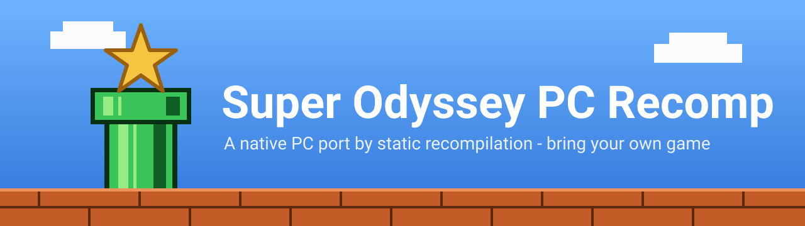
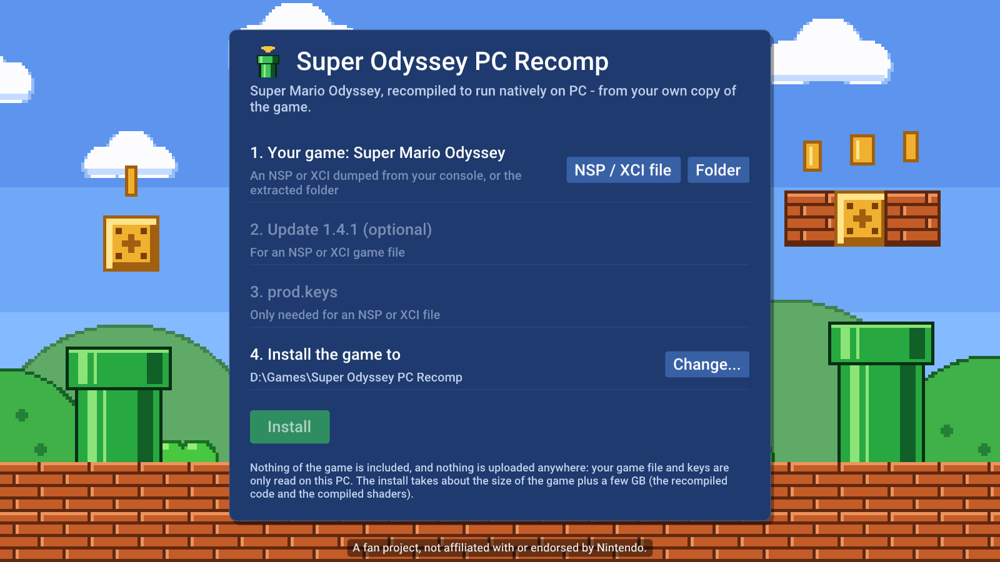

# Super Odyssey PC Recomp

  <a href="../../releases/latest"><b>Download</b></a> ·
  <a href="#get-started">Get started</a> ·
  <a href="docs/STATUS.md">Status</a> ·
  <a href="#known-issues">Known issues</a> ·
  <a href="../../issues">Issues</a> ·
  <a href="docs/release-notes-0.4.0.md">Release notes</a>

<b>A native PC port of Super Mario Odyssey for Windows and Linux, made by static recompilation - from your own copy of the game.</b>

  
  
  
  

Captured in this port at 3840 x 2160, Frame rate 240, on the maintainer's PC. The game is © Nintendo; you need your own copy to run it.

> [!IMPORTANT]
> **You must bring your own game.** This project contains **no game files, no game code and no assets** -
> only the installer and the source code. To play, you need the **`exefs` and `romfs` folders of your own copy of
> Super Mario Odyssey**, already extracted. Instructions for getting game files are
> not provided, and requests for game files will be closed.

> [!NOTE]
> **This is an AI-made project.** The code of this port was written by AI: almost all of it by **Claude**
> (Anthropic's AI model, through Claude Code), with some fixes and features from OpenAI's **Codex**. The maintainer
> doesn't write the code; they direct the work, test every build on Windows and a Steam Deck, and run the releases.
> See [Who made this](#who-made-this).

> [!WARNING]
> **This is a preview.** The whole game can be played from start to end, but there are known issues (see
> [Known issues](#known-issues)). Please report what you find.

## Features

- **The whole game**, on game version **1.0.0** or **1.4.1**, recompiled on your PC from your own files - no emulator
  runs while you play
- **Frame rates from 60 to 240 FPS**, every frame really drawn, gameplay at the Switch's speed; **Match display** picks
  the smoothest rate for your screen; game speed stays real time when frames drop
- **Resolutions up to 4K and beyond**: up to 4x internal resolution, with the **HUD drawn at full resolution**
- **Upscaling and anti-aliasing**: NVIDIA **DLSS / DLAA**, AMD **FSR 2 / 3.1 / 4**, Intel **XeSS**, FSR 1, SMAA, FXAA;
  **frame generation** (AMD FSR, NVIDIA DLSS beta) with NVIDIA Reflex
- **No shader stutter**: every shader compiled ahead of play, and again by itself after a driver or game update
- **Any screen shape**: 16:9, 16:10, 21:9, 32:9, 4:3 or Fill window, with the HUD at the edges on ultrawide
- **Shadow quality and texture detail** options, the game's own dynamic resolution on or off
- **Keyboard and mouse** with a real mouse camera and mouse in the game's menus; **any controller**, Joy-Con pairs,
  **motion controls as on the Switch**; button prompts that match your device
- **Steam Deck**: 1280x800 at 60 FPS at 10 W in Gaming Mode, with Deck defaults
- **RomFS mods**, the **Brazilian Portuguese** fan translation, 5.1 surround, Discord activity (off by default)
- **One-click updates** from the in-game menu, crash reports with one button

## Get started

**You need:** Windows 10 / 11 (x64), or Linux / Steam Deck (experimental); a GPU with Vulkan 1.3; 8 GB RAM (16 GB
recommended); about 12 GB free disk space; a 64-bit CPU (AVX2 recommended, older CPUs supported but slower); and the
extracted `exefs` and `romfs` folders of your own Super Mario Odyssey (1.0.0, or 1.4.1 with the update applied).

1. Download the latest build from [Releases](../../releases/latest):
   - **Windows:** the file ending in `windows.zip`. Extract it anywhere you own (for example `D:\Games`, **not**
     Program Files) and start `SuperOdysseyRecomp.exe`. It isn't code-signed: if SmartScreen says "Windows protected
     your PC", choose *More info*, then *Run anyway*.
   - **Linux and Steam Deck:** the file ending in `x86_64.AppImage`. Make it executable and run it
     ([docs/linux.md](docs/linux.md)).
2. The installer asks for **your game** (the folder holding `exefs` and `romfs`; for 1.4.1 the full `romfs` with the
   update applied, not only the update's) and **where to install** (game data, saves and shaders, about 12 GB).
3. Press **Install**. It copies the game data, recompiles the game code for your PC (a few minutes) and compiles every
   shader (several minutes, once). Your own files aren't changed.
4. Press **Play**.

**Updating:** the game checks for new versions at start (only GitHub is contacted; you can switch this off). Menu
(**F1**) > **Updates** > **Download and install**, then **Restart now**. Or extract the new zip over your folder.
Your game files, saves, settings and mods stay; shaders are prepared again once if needed.

## Status

| Area | Progress |
|---|---|
| Core game |  |
| Stability |  |
| Performance |  |
| Graphics options |  |
| Platforms and input |  |
| Player features |  |

What each area covers, what is done and what is left: [docs/STATUS.md](docs/STATUS.md).

### Current focus

1. **No crashes, no stutter, steady memory.** Every release is tested on Windows and a Steam Deck, with both game
   versions, before it goes out.
2. **1:1 with the Switch at 60 FPS**: every kingdom compared with the Switch version, side by side.
3. **Lower CPU use**, so high frame rates and low-end PCs run better.

## Known issues

- **Entering a painting above 60 FPS on game 1.0.0 can crash** (#85, #72). Use Frame rate 60 for paintings until
  it's fixed.
- **Switching the upscaler while FSR frame generation is on can crash** (#77): turn frame generation off first.
- **Linux with AMD RX 7000 GPUs** can hang the GPU when play starts (#21).
- **Sound crackling or distortion** has been reported on 0.4.0 (#83, #84).
- **Upscalers in some cutscenes** can show broken blocks where the game lowers its own resolution (#66).
- **Linux and Steam Deck are experimental**: less tested than Windows ([docs/linux.md](docs/linux.md)). The Steam
  Deck's own gyro isn't read yet (#68).
- **Online features** (anything that needs Nintendo's servers) don't work. **Code mods** (exefs patches, IPS /
  pchtxt) can't be used: the game code is rebuilt from the original. RomFS mods work.
- **Windows Defender** may flag the new, unsigned program by its machine-learning guess (a `!ml` detection). Please
  report it as a false positive at https://www.microsoft.com/wdsi/filesubmission and open an issue with the name.

All open reports: [issues](../../issues).

## Reporting a problem

Open an [issue](../../issues) with:

- what happened and where in the game (a screenshot or video helps),
- your game version (1.0.0 or 1.4.1), Windows / Linux / Steam Deck, CPU and GPU,
- the crash report (the **Copy crash report** button), or the log `SuperOdysseyRecomp.log` from the install folder
  (it's overwritten at each start, so grab it right after the problem; it contains no game files).

For a graphics glitch, pressing **F9** where it happens saves the frame's details into the log.

## Settings

Open the menu with **F1** or **Esc** (controller: Home / Guide button). Switch tabs with L / R (Q / E); the text on
the right explains the selected setting and what is recommended.

- **Display**: windowed, borderless or exclusive fullscreen, display resolution and refresh rate, aspect ratio, VSync
  (On, Fast, Adaptive, Off)
- **Graphics**: internal resolution, upscaling (DLSS / DLAA, FSR 2 / 3.1 / 4, XeSS, FSR 1), anti-aliasing (SMAA,
  FXAA), frame generation, shadow quality, texture detail, anisotropic filtering, the game's dynamic resolution
- **Performance**: frame rate (60 to 240, Match display), early frame hand-off, multithreaded rendering, shader
  options, performance overlay, Discord activity
- **Audio**: volume, reverb, movie audio, audio output, mute in background
- **Controls**: language, motion controls, vibration, stick deadzone, mouse camera, button prompts, skip the start-up
  controller screen, key and button rebinding
- **Mods**: switch RomFS mods on and off
- **Updates**: this version, check / install updates, the project page

## Controls

| Switch | Keyboard | Controller |
|---|---|---|
| Left stick | W A S D | left stick |
| Right stick (camera) | mouse, or Num 8 / 4 / 5 / 6 | right stick |
| A / B / X / Y | K / J / L / I | by position (east = A, south = B) |
| L / R, ZL / ZR | Q / E, 1 / 3 | shoulder buttons / triggers |
| + / - | Enter / Backspace | Start / Back |
| Stick clicks | F / Num 0 | stick clicks |
| D-pad | arrow keys | d-pad |

Fullscreen: F11 or Alt+Enter. Everything can be rebound in the menu.

The mouse turns the camera while you play: the pointer stays in the window until you open the menu (Esc) or switch to
another window. Sensitivity, invert up / down, or switching it off: menu > Controls > Mouse.

The game's button icons follow what you play with: after a key press or mouse movement they show the keys you bound
(WASD for moving, a mouse for the camera), after a controller press that controller's own buttons: Xbox (A B X Y,
LB / RB / LT / RT), PlayStation (cross circle square triangle, L1 / R1 / L2 / R2) or the Switch's. With two controllers
connected, the one you press a button on takes over. Menu > Controls > *Button prompts* can fix them to one style.

Motion controls (shake to throw Cappy at a target, and the game's other motion moves) use the controller's gyro and
accelerometer: PlayStation and Switch Pro controllers. Menu > Controls > *Motion controls* turns them off.

## Files

The program folder holds the program; the install folder (the same one unless you chose another) holds:

- `extracted\` - your game data as the installer wrote it and the game code built from it (`odyssey_game.dll`)
- `save\` - your saves, `cache\` - compiled shaders, `powermoon.ini` - settings, `SuperOdysseyRecomp.log` - the log
- `mods\` - optional RomFS mods, each in its own folder (`mods\<Mod name>\romfs\...`; the Atmosphere layout works too)

Never share `extracted\` or anything built from it: it's Nintendo's game.

### Brazilian Portuguese fan translation

The separately obtained **JumpManClub Brasil v1.1** RomFS mod can be selected
with **Controls > System language > Português (Brasil)**. It uses the game's
US English slot, and the menu reports whether the complete known package is
enabled without conflicting files. See [installation, limitations and credits](docs/PT-BR.md).
If the translation is missing, selecting the language offers to download and install
the official package. Confirm the installation, then restart when prompted.
No translation files are bundled; no download starts without confirmation.

## Building from source

Needs MSYS2 (UCRT64: clang, SDL3, FFmpeg, shaderc, Python) - `tools\setup_windows.ps1` installs them. See
[docs/BUILD-windows.md](docs/BUILD-windows.md).

1. Put your extracted game folders into `extracted\` (`extracted\exefs\`, `extracted\romfs\`), or start the built
   program and let its installer copy them there.
2. From an MSYS2 UCRT64 shell in this folder:

       make gen        # recompile the game from extracted/exefs into generated/
       make -j16       # build/SuperOdysseyRecomp.exe and the game code, build/odyssey_game.dll
       make dlls       # copy SDL3 / FFmpeg / shaderc DLLs next to the exe

3. A release: `make deps-windows` (an LGPL-only FFmpeg), `make gen-helper`, `tools/fetch_zig.sh`, then `make dist`.
   The zip holds no game code.

## How it works

- `tools/` - the recompiler (Python): `gen.py` lifts every function of the game's NSO modules to C (`lifter.py`);
  `odyssey_patches.py` holds the few game-specific patches for 1.0.0 and 1.4.1.
- `runtime/` - the program: module loader, a small Horizon kernel, IPC services, HLE of SDK functions, NVN on Vulkan
  with a Maxwell shader translator (`runtime/nvn`), movies with FFmpeg, the menu (Dear ImGui), the installer
  (`runtime/ui/setup.mm`), the game code build (`runtime/gamebuild.c`) and the updater (`runtime/updater.c`).
- Debugging tools are environment variables (`ODYSSEY_*`), documented where they're read.

## Who made this

**The code of this port was written by AI, not by the maintainer.** Nearly all of it was written by **Claude**
(Anthropic's AI model, working through Claude Code): the recompiler's patches, the runtime, the Vulkan renderer, the
installer, the Linux version and the release pipeline. OpenAI's **Codex** contributed a number of fixes and features.

The maintainer, [Simon3Sarkis](https://github.com/Simon3Sarkis), hasn't written the code. What they do:

- decide what gets worked on and in what order, and what's good enough to ship
- test every build on their own PC and a Steam Deck, on both game versions, before anything is released
- play through the game to find bugs, reproduce what players report, and compare the port with the Switch version
- run the project: the issues, the replies to players, the releases

Bug reports are read and worked on the same way: the maintainer tests, and Claude writes the fix.

## Credits

- **Power Moon Recomp** by its contributors - the Super Mario Odyssey port this project continues (MIT license); its
  original repository is no longer online.
- **[LAS Recomp](https://github.com/peiikai/LASRecomp)** by Peiikai and its contributors - the static recompiler,
  runtime and renderer Power Moon Recomp is built on, and the frame interpolation (MIT license).
- **[PrimeRecomp](https://github.com/gminustwo/primerecomp)** by its contributors - the GPU ASTC texture decoder
  (`runtime/nvn/vulkan/astc_gpu.c`) and its GPU scratch memory (MIT license).
- **[MacNativeGames](https://github.com/ly05010419/MacNativeGames)** - the game package reading code `runtime/nxpkg.c`
  is ported from (MIT license, `tools/vendor/macnativegames`), and
  **[TotK PC Recomp](https://github.com/valentderah/totk-pc-recomp)**'s hactool build script (`tools/build_hactool.py`,
  MIT) used for checking
- [OdysseyDecomp](https://github.com/MonsterDruide1/OdysseyDecomp) - names and structure of the game's code, used for
  reading and debugging (no code from it is in this repository)
- [Switchbrew](https://switchbrew.org) and [envytools](https://github.com/envytools/envytools) - documentation of the
  Switch's system interfaces and the Maxwell GPU
- An MIT-licensed open-source project's audio renderer and shader instruction decoders (`third_party/ryujinx/LICENSE.txt`)
- Libraries: [SDL 3](https://libsdl.org) (zlib), [FFmpeg](https://ffmpeg.org) (LGPL, linked dynamically),
  [Dear ImGui](https://github.com/ocornut/imgui) (MIT), [Vulkan Memory Allocator](https://github.com/GPUOpen-LibrariesAndSDKs/VulkanMemoryAllocator) (MIT),
  [shaderc](https://github.com/google/shaderc) (Apache 2.0), [SMAA](https://github.com/iryoku/smaa) (MIT),
  [AMD FSR 1](https://github.com/GPUOpen-Effects/FidelityFX-FSR) (MIT), the [Roboto](https://github.com/googlefonts/roboto)
  font (Apache 2.0), NVIDIA DLSS (NVIDIA RTX SDK license)
- In the release, to build the game code on your PC: [Zig](https://ziglang.org) (MIT) with LLVM / Clang / LLD (Apache
  2.0 with LLVM exception) and MinGW-w64 headers; the generator runs on [Python](https://www.python.org) (PSF license)
  with [Capstone](https://www.capstone-engine.org) (BSD), [Unicorn](https://www.unicorn-engine.org) (GPL 2.0) and
  [LZ4](https://github.com/python-lz4/python-lz4) (BSD). The release carries every licence in `licenses/`.

The installer's pixel-art background and the icon are original artwork made for this project.

## Contributing

Bug reports, logs and pull requests are welcome - see [Reporting a problem](#reporting-a-problem) for what a report
needs. Every pull request is checked line by line for anything harmful, then built and played on **Windows and a
Steam Deck** before it is merged; nothing from a contributor ships untested. Never include or link game files.

**Contributors**

- **[galaxyhf](https://github.com/galaxyhf) (Caio Silva)** - Brazilian Portuguese: the localization support, the
  Language tab and the fan translation's installer (#49, #56, #58).
- **zzzarathustra-dev** - shaders precompiled before the first start and the first Steam Deck defaults (0.2.1).
- **Codex** (OpenAI) - fixes and features across the runtime (see [Who made this](#who-made-this)).
- Everyone who reported a bug with logs, screenshots and saves: most of the fixes below started there.

## How the shader stutter was solved

A Switch game ships its shaders ready for one GPU. On a PC every shader has to be translated (Maxwell -> GLSL ->
SPIR-V) and then compiled by your graphics driver - and the first time an effect appears, that compile is a stutter.
What fixed it, measured on an RTX 4090 and a Steam Deck:

1. **Compile everything ahead of play.** The launcher scans the game's own shader archives (about 32,800 programs),
   translates every one and builds its pipeline pieces, saving them as `VK_KHR_pipeline_binary` data. It asks first,
   shows progress and time left, and keeps what's done if you stop it.
2. **Make sure the game finds what was compiled.** A piece is looked up by its content plus the driver's own key; if
   the compile and the game build anything even slightly differently, every lookup misses and the work is wasted.
   The log reports what was loaded, refused or missing, so coverage can be checked.
3. **Compile again when the cache goes stale.** A GPU driver update makes the driver refuse saved pieces, and a new
   version of the game may translate shaders differently. The cache now records the GPU, driver and version it was
   made for and is rebuilt (after asking) when any of them changes - this was the stutter many players still saw.
4. **Never freeze the picture for an effect.** If a piece isn't ready, that one draw waits a frame or two on another
   thread; only real full-screen passes (lighting, composites) hold the frame.
5. **Less work for the driver.** A post-pass inlines the translator's one-instruction helper calls and strips debug
   data from the SPIR-V: about 45% less driver time per shader on a Steam Deck.
6. **Use the whole CPU.** The compile runs on every core but one (137 s -> 110 s from nothing on a 32-thread CPU).

Tested the strict way: game cache deleted, the driver's own cache emptied, full compile, then play - no shader built
while playing, on Windows and on the Steam Deck. A first compile takes about 2 minutes on a fast PC and about 6 on a
Deck.

## Steam Deck optimizations

What took the Deck to a steady 1280x800 at 60 FPS in Gaming Mode at 10 W:

- **Don't wait for the GPU when the game doesn't need to.** The game waited for its whole GPU frame every frame
  (fences); it now continues once the render thread has its data, and waits only where the GPU writes game memory:
  45 -> 58-60 FPS in busy views.
- **Guarded GPU writes**: GPU results copied back into game memory protect their pages instead of forcing a wait; only
  a thread that actually touches them waits. The first Cap Kingdom visit went from 46-49 FPS to ~60.
- **A separate compute queue** for small dispatches that write game memory, so they never queue behind a frame.
- **Map the game's memory straight into Vulkan** (`VK_EXT_map_memory_placed`): about 3 ms less per submission that
  the AMD driver spent re-checking an imported pointer.
- **Loading stutters**: file decompression runs outside the emulated CPU core it was blocking (12-26 ms hitches when
  new things loaded), and a first CPU read of GPU data (the fog) no longer waits for the GPU.
- **Frame pacing**: the game's 60 Hz timer is locked to when the screen really shows each frame (present wait), so
  frames aren't shown twice or skipped.
- **The game's own dynamic resolution** dropped to its floor on the Deck and stayed there; it can be turned off (off by
  default on the Deck), and its GPU timing now counts busy time only.
- **Power**: CPU and GPU share the Deck's power budget, so CPU time saved is GPU clock gained; at a low power limit a
  manual GPU clock of 1000 MHz keeps 60 FPS (the launcher shows this tip).
- **Deck defaults**: 16:10 picture, Handheld console mode, FSR 2 available for Docked mode.

## Performance techniques for other projects

Everything above - and more: frame pacing, native high frame rates, drawing the HUD after upscaling, keeping game
speed real time below 60 FPS, mip chains without copies, any screen shape - is written up with how it was measured in
**[docs/OPTIMIZATIONS.md](docs/OPTIMIZATIONS.md)**, for anyone building a recompiled or emulated port. The code it
points to is MIT licensed: take what helps.

## Legal

This is a fan project. It is not affiliated with, endorsed by or sponsored by Nintendo. *Super Mario Odyssey* and
*Nintendo Switch* are trademarks of Nintendo. No game files, game code, assets or fonts are included in this
repository or its releases, and nothing built from your game files (`extracted/`, `generated/`, `odyssey_game.dll`)
may be shared. You must provide the extracted files of your own legally obtained copy of the game.

## License

The code of this repository is under the [MIT License](LICENSE) (it keeps LAS Recomp's and Power Moon Recomp's
copyright notices). Third-party components keep their own licenses (above, and in `third_party/`). The license covers
this project's code only - it grants nothing for Nintendo's game.
